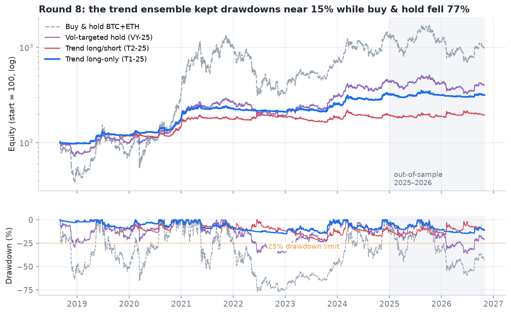
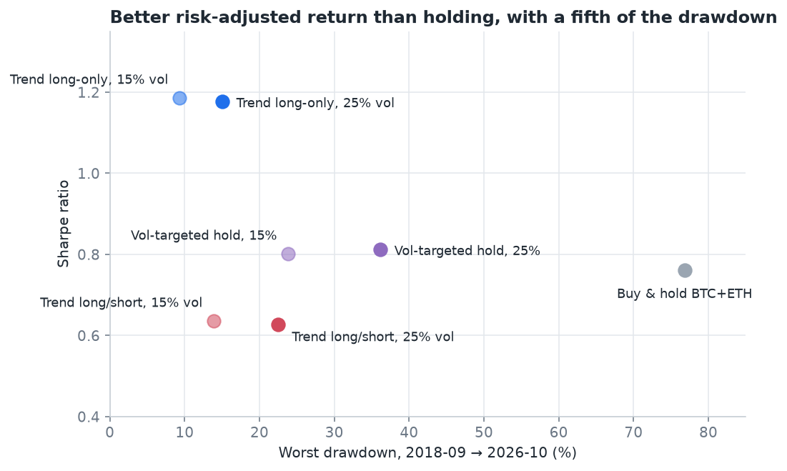
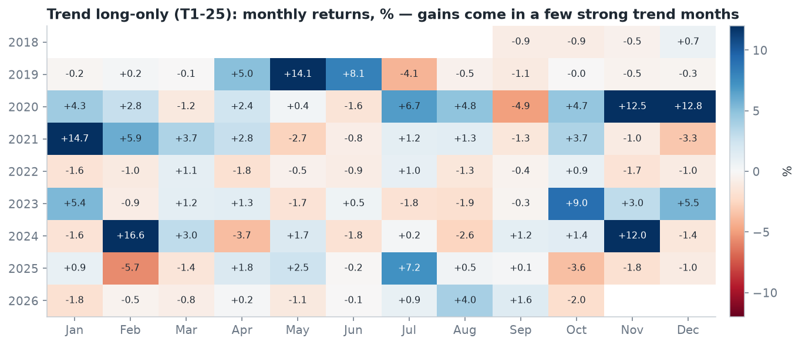
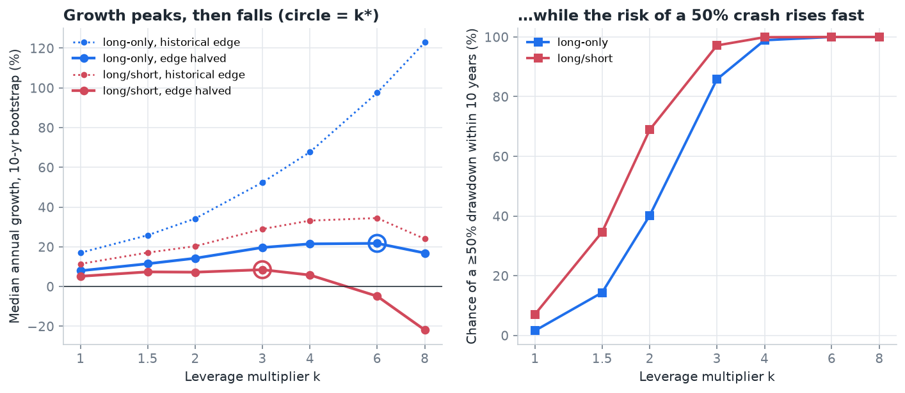
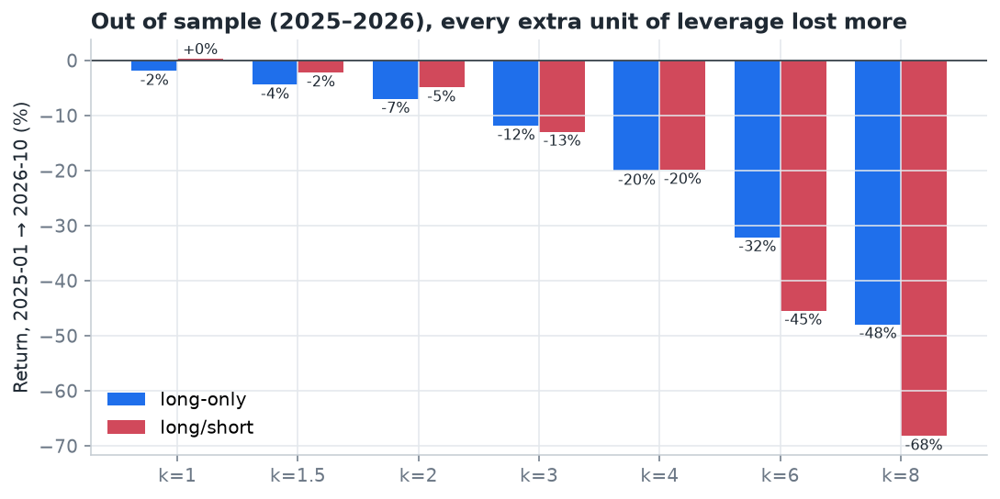
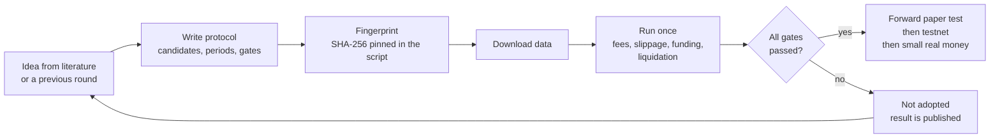
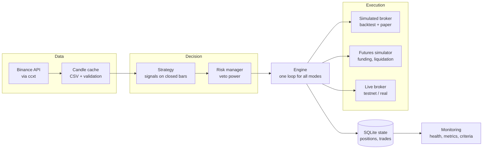

<div align="center">

# Ballast

**Pre-registered research and risk-first execution for systematic crypto strategies**


[](https://github.com/burakkaygusuzoglu/ballast/actions/workflows/ci.yml)


*Ballast keeps a ship upright in rough water. This project puts risk control first, and then asks whether
there is an edge at all.*

[Türkçe özet](README.tr.md) · [Results](#results) · [Protocol registry](docs/research/PROTOCOL_REGISTRY.md) · [Design decisions](docs/adr/README.md)

</div>

> **Not financial advice.** This is a research and engineering project. Backtests are not forecasts, and nothing
> here is a recommendation to buy, sell or use leverage.

---

## In one minute

Ballast is a complete trading system for Binance, built in Python. It can download data, backtest, run a
paper trader and send real orders. It is also a research lab that tested **nine rounds of strategy ideas under
rules written before the data was seen.**

| | |
|---|---|
| **Question** | Can a small account grow meaningfully with a systematic crypto strategy, and does leverage help? |
| **Method** | Each round's candidates, parameters and pass/fail gates were written down and hashed *before* any backtest. Each round ran once, with realistic fees, slippage, funding and liquidation. |
| **Best result** | A multi-horizon trend ensemble with volatility targeting. Sharpe **1.18** vs **0.76** for buy & hold, worst drawdown **15 %** vs **77 %** (2018-09 → 2026-10). |
| **Honest verdict** | It still failed its own gate. It lost **1.1 %** in 2025–2026 while the rule demanded a profit in every period, so it was **not adopted**. Leverage multiplied growth in-sample but lost more out-of-sample. |
| **Engineering** | Shared engine for backtest, paper and live trading. A risk manager with veto power. 287 tests, including mutation-tested research rules. |

---

## Results

### Round 8: the best risk-adjusted system so far



The trend ensemble (blue) followed the big moves of 2019–2021 and 2023–2024 and stepped aside in the bear
markets. Buy & hold earned more in total but fell 77 % from its peak along the way.



| Setup (10,000 USDT, fees + slippage + funding) | 2018-09 → 2021 | 2022 → 2024 | 2025 → 2026-10 | Full period | Worst drawdown | Sharpe |
|---|---:|---:|---:|---:|---:|---:|
| **Trend long-only, 25 % vol target (T1-25)** | +126.5 % | +40.8 % | **−1.1 %** | +215.5 % | 15.1 % | **1.18** |
| Trend long-only, 15 % vol target (T1-15) | +63.9 % | +24.5 % | −0.005 % | +104.3 % | 9.3 % | 1.19 |
| Trend long/short, 25 % (T2-25) | +75.4 % | +10.3 % | +0.3 % | +94.2 % | 22.5 % | 0.63 |
| Vol-targeted hold, always long (VY-25) | +164.0 % | +60.4 % | −10.7 % | +302.9 % | 36.2 % | 0.81 |
| Buy & hold, half BTC / half ETH | +881.2 % | +46.4 % | −21.3 % | +897.8 % | 76.8 % | 0.76 |

**What this shows**

- **The trend signal adds value.** The same sizing, always long (VY), reaches a Sharpe of 0.81. The trend signal
  lifts it to 1.18, which matches the published literature.
- **The short side hurts.** Long/short paid more than 3,000 USDT in funding and halved the Sharpe ratio, as in
  round 6.
- **The gate was strict on purpose.** "Profit in every period" failed by 1.1 %, and T1-15 missed by
  half a dollar on 10,000. A near miss is still a miss.



Most of the return arrives in a handful of strong trend months. The rest are small gains and small losses,
which is the usual profile of trend following.

### Round 9: does leverage make it grow faster?

The growth-optimal (Kelly) leverage maximises long-run compound growth. Above it, growth slows; at twice it,
a profitable system stops growing at all. Round 9 scaled the round-8 portfolio by k = 1 … 8, modelled intraday
liquidation, and estimated the growth peak with the strategy's edge **halved**. Published edges typically shrink
by about half after publication (McLean & Pontiff, 2016).





- **In-sample (2018–2024), leverage looked spectacular.** The growth peak sat at k = 6 (halved edge) to k = 8
  (historical edge).
- **Out-of-sample (2025–2026), every extra unit of leverage lost more.** Long-only lost 2 % at k = 1, 7 % at
  k = 2 and 48 % at k = 8.
- **The price of leverage is drawdown.** With the halved edge, the chance of at least one 50 % crash within
  ten years is 40 % at k = 2 and 86 % at k = 3.
- **Decision: leverage not recommended.** No direction was eligible after round 8, and the validation would
  have failed anyway.

---

## How the research works



- **No tuning after the fact.** A script refuses to run if its protocol file changed, so a gate cannot be
  softened once the results are known. See the [protocol registry](docs/research/PROTOCOL_REGISTRY.md).
- **Separate periods.** Discovery, validation and a locked "exam" period are kept apart. Data from a later period
  is not even loaded while an earlier stage runs.
- **Realistic costs.** 0.1 % spot fee (0.05 % on futures), 0.05 % slippage on every market or stop fill,
  historical funding rates, exchange minimum order sizes and lot steps.
- **Robustness checks.** Each round reports parameter neighbourhoods, block-bootstrap Monte Carlo (20-day
  blocks, 10,000 paths, fixed seeds) and small-account feasibility.

### The nine rounds

Each round tested 2–5 candidate strategies against **pass/fail gates written before the data was seen**
(for example: profitable in every test period, maximum drawdown under 25 %, better risk-adjusted return than buy
and hold). A candidate is adopted only if it passes **every** gate; the gates were never changed after the results
were known. How to read the *Outcome* column:

- ✓ **Passed**: at least one candidate cleared every gate and was adopted.
- ✗ **No candidate passed**: every candidate failed at least one gate, so nothing was adopted.

| # | Idea | Outcome | Lesson |
|---|---|---|---|
| 1 | Four hourly strategies (mean reversion, breakout, trend) | ✗ No candidate passed | On hourly bars, fees and slippage ate the edge. Only trend following was robust. |
| 2 | Trend following on a rule-selected 10-coin universe | ✗ No candidate passed | Worked in 2022–2024 and failed in 2025–2026. Correlated stops hit together. |
| – | **C1** locked: 4h channel breakout 20/10, 12 coins, 0.5 % risk | ✓ Passed its exam period | Became the reference bot |
| 3 | Five C1 improvements (regime filter, pyramiding, momentum rotation …) | ✗ No candidate passed | The BTC regime filter (R1) helped; momentum rotation did not survive validation |
| 4 | Momentum rotation on 27 coins | ✗ No candidate passed | A wider universe made it worse |
| 5 | Long-term 200-day trend and a blend, plus the exam period | ✗ Not adopted | C1 +12.7 % and R1 +14.7 % in a locked six-month exam |
| 6 | Futures: leverage and shorting for C1 / R1 | ✗ No candidate passed | More risk did not bring more growth; shorts and funding cost money |
| 7 | Drawdown-scaled risk (Grossman–Zhou) | ✗ No candidate passed | Protection worked, but returns fell and small orders were skipped |
| 8 | Multi-horizon trend ensemble + volatility targeting | ✗ No candidate passed | Best risk/return so far, but −1.1 % in 2025–2026 |
| 9 | Growth-optimal (Kelly) leverage | ✗ Not recommended | In-sample growth, out-of-sample losses |

**The overall finding:** with honest costs and out-of-sample checks, no setting turned a small account into
"thousands of times" its size. What grows an account in currency terms is capital and time. More risk,
leverage or shorting did not help.

---

## System architecture



- **One engine, three modes.** Backtest, paper and live trading run the same engine and the same fill model,
  so a paper trade can be compared with its backtest trade by trade.
- **The risk manager can veto any order.** It enforces risk per trade, position caps, daily loss limits, a
  drawdown circuit breaker, cooldowns and a cost filter.
- **Safety in live mode.** API keys live only in `.env`, which git ignores. The bot refuses to start if the key
  can withdraw funds. Real-money mode needs an explicit typed confirmation, and `baslat_penceresi.py` only allows a start inside a
  safe window right after a candle closes.
- **Monitoring.** `izleme.py` builds a read-only dashboard: bot health, performance and progress against
  the forward-test criteria.

### Repository map

| Path | What it is |
|---|---|
| `bot/engine.py` | Event loop: closed-bar processing, order lifecycle, stops |
| `bot/risk.py` | Risk manager: position sizing, limits, circuit breaker, drawdown-scaled risk |
| `bot/strategy.py`, `bot/candidates.py`, `bot/signals.py` | Signal generation (channel breakout, regime filter, momentum, long-term trend) |
| `bot/trend_toplulugu.py` | Round 8: multi-horizon trend ensemble and volatility targeting |
| `bot/hedef_agirlik.py` | Target-weight daily portfolio backtester: spot and futures, funding, cross-margin liquidation |
| `bot/buyume.py` | Round 9: common-random-number block bootstrap, haircut edge, time-to-target with contributions |
| `bot/brokers/` | Simulated, futures and live brokers behind one interface |
| `bot/portfolio.py`, `bot/storage.py` | Accounting and SQLite state |
| `bot/data.py`, `bot/exchange.py` | Data download, cache, validation, ccxt wrapper with retries |
| `arastirma*.py` | Research runners, one per round (`arastirma` = "research", `tur` = "round") |
| `run.py`, `backtest.py`, `izleme.py` | Paper/live runner, backtest CLI, monitoring dashboard |
| `config/` | Strategy and risk settings: the live reference bot and the shadow bots |
| `docs/` | Round 6–9 protocols, [protocol registry](docs/research/PROTOCOL_REGISTRY.md), [architecture decision records](docs/adr/README.md), literature review |
| `.github/workflows/ci.yml` | CI: ruff lint plus the full test suite on Linux and Windows, with coverage |
| `tests/` | 287 tests: accounting invariants, causality (no look-ahead), protocol rules, paper/backtest equivalence |

> **About the language.** The project started in Turkish, so module names, comments and console messages are
> Turkish. Translating them to English is the next step on the roadmap. The README and the registry are in English.

---

## Getting started

```bash
git clone https://github.com/burakkaygusuzoglu/ballast.git
cd ballast
python -m venv .venv && source .venv/bin/activate      # Windows: .venv\Scripts\activate
pip install -r requirements.txt
pytest -q                                               # 287 tests, no network needed
ruff check .                                            # lint (pip install ruff)
```

**Download data and backtest the reference bot** (public market data, no API key needed):

```bash
python download_data.py          # hourly candles for the configured coins
python backtest.py               # development period, with fees and slippage
```

**Reproduce rounds 8 and 9:**

```bash
python tur8_veri.py              # BTC & ETH daily candles since 2017, futures funding history and rules
python arastirma_tur8.py         # trend ensemble, run once against its protocol
python arastirma_tur9.py         # growth-optimal leverage
```

**Paper trading** (live prices, virtual balance):

```bash
python run.py --mode paper
python run.py --status
```

Live trading (`--mode live --testnet` or `--gercek`) needs keys in `.env` (see `.env.example`). Use read and
spot-trade permissions only, keep withdrawals disabled and turn on the IP whitelist.

---

## Testing and quality

- **287 tests** run offline with synthetic candles and a fake exchange, on Linux and Windows in CI.
- **92 % line coverage** of the `bot/` package (risk manager 98 %, engine 94 %, live broker 82 %). The thin ccxt wrapper
  is the least covered part (26 %), because it only forwards network calls.
- **Lint-clean** under ruff (pycodestyle, pyflakes, isort, bugbear, simplify, timezone and exception rules). The
  few deliberate broad `except` blocks are fail-safe boundaries around exchange calls and are listed in `pyproject.toml`.
- **No look-ahead.** Signals computed on a truncated history must match the full-history signals bar for bar.
- **Accounting invariants.** Equity equals cash plus positions; spot never borrows; funding has the right sign
  for longs and shorts; liquidation triggers at the maintenance margin.
- **Protocol rules as code.** Gate logic, profile selection and the bootstrap are unit-tested. The tests were
  mutation-checked: 27 deliberately broken versions of the rules must each make a test fail.
- **Paper/backtest equivalence.** The paper engine and the backtest produce identical trades on the same data.

---

## Privacy and security

- **What this repository does not contain:** keys, `.env` files, account balances, personal trade records,
  machine paths or location data.
- **Placeholder account size.** The small-account scenario in the code is a 50 USDT placeholder.
- **Redacted protocols.** Round protocols were redacted where they named personal details. The registry lists
  both the original and the public fingerprints.
- **Report your findings privately.** See [SECURITY.md](SECURITY.md).

---

## Roadmap

- [x] Nine pre-registered research rounds with published outcomes
- [x] Futures simulation with funding and cross-margin liquidation
- [ ] English codebase, `src/` package layout, type checking and CI on Linux and Windows
- [ ] Deflated Sharpe ratio and probability of backtest overfitting across all trials
- [ ] Transaction-cost analysis: paper and testnet fills against model assumptions
- [ ] Pre-trade controls in the style of MiFID II RTS 6, reconciliation, alerts, cloud deployment
- [ ] Model documentation in the style of SR 11-7 and an independent validation report

---

## References

- Zarattini, Pagani & Barbon (2025). *Catching Crypto Trends: A Tactical Approach for Bitcoin and Altcoins.*
- Kelly (1956); Breiman (1961); Thorp (2006). *The Kelly Criterion in Blackjack, Sports Betting and the Stock Market.*
- MacLean, Thorp & Ziemba (2010). *Good and Bad Properties of the Kelly Criterion.*
- McLean & Pontiff (2016). *Does Academic Research Destroy Stock Return Predictability?* Journal of Finance 71(1).
- Grossman & Zhou (1993). *Optimal Investment Strategies for Controlling Drawdowns.* Mathematical Finance 3(3).
- Bailey & López de Prado (2014). *The Deflated Sharpe Ratio.* Journal of Portfolio Management 40(5).
- Board of Governors of the Federal Reserve & OCC (2011). *SR 11-7: Guidance on Model Risk Management.*

The literature review behind the research choices (in Turkish) is in
[docs/research/literature_review_tr.md](docs/research/literature_review_tr.md).

---

<div align="center">

Built by **Burak Kaygusuzoğlu** · MIT License

</div>
