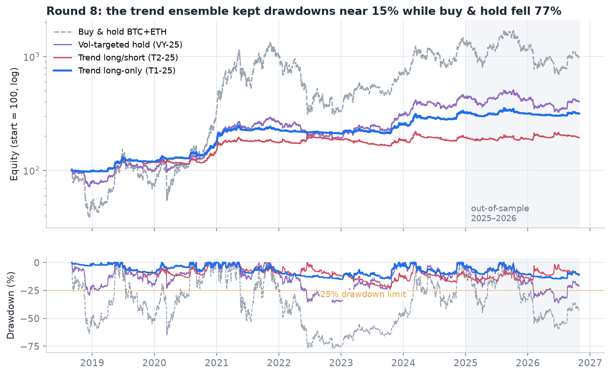

# Ballast (Türkçe özet)

**Sistematik kripto stratejileri için önceden kaydedilmiş araştırma ve risk öncelikli işlem sistemi**

[English README](README.md) · [Protokol kayıt defteri](docs/research/PROTOCOL_REGISTRY.md)

> **Yatırım tavsiyesi değildir.** Bu bir araştırma ve mühendislik projesidir. Backtest sonuçları geleceği
> göstermez.

## Proje nedir?

Ballast, Python ile yazılmış eksiksiz bir Binance işlem sistemidir:
- veri indirir ve doğrular,
- backtest yapar,
- sanal parayla çalışır,
- gerçek emir gönderebilir.

Aynı zamanda bir araştırma laboratuvarıdır. **Dokuz araştırma turunun her birinde kurallar, veriye bakılmadan önce
yazıldı ve parmak iziyle (SHA-256) sabitlendi.** Her tur bir kez çalıştırıldı. Hesaba katılan maliyetler:
komisyon, kayma, funding ve likidasyon.

## Ana sonuçlar

| | |
|---|---|
| **En iyi sistem** | Çok vadeli trend topluluğu ve volatilite hedefleme (yalnızca long, kaldıraçsız). 2018-09 → 2026-10 arasında Sharpe **1,18**; al-tut'ta **0,76**. En kötü düşüş **%15**; al-tut'ta **%77**. |
| **Karar** | Sistem 2025-2026'da **-%1,1** yaptı. "Her dönemde kâr" kuralını geçemedi, bu yüzden **benimsenmedi**. Kural sonradan değiştirilmez. |
| **Kaldıraç** | 2018-2024'te büyümeyi katlıyordu, 2025-2026'da her kaldıraç seviyesi daha çok kaybettirdi. **Kaldıraç önerilmez.** |
| **Short** | Her denemede sonucu kötüleştirdi; funding maliyeti de ekledi. |
| **Genel ders** | Gerçekçi maliyetler ve dönem dışı testlerle, küçük bir hesabı "binlerce kat" büyüten bir ayar bulunamadı. Para büyümesinin asıl kaynağı sermaye ve zamandır. |

## Dokuz tur, kısaca

| Tur | Fikir | Sonuç |
|---|---|---|
| 1 | Saatlik dört strateji | Geçmedi: maliyet kârı yedi |
| 2 | 10 coinde trend takibi | Geçmedi: 2025-2026'da çalışmadı |
| – | C1 (4 saatlik kanal kırılımı) kilitlendi | Sınav döneminde geçti; referans bot oldu |
| 3 | C1 iyileştirmeleri | Geçmedi: rejim filtresi (R1) umut verdi |
| 4 | 27 coinde momentum | Geçmedi |
| 5 | Uzun vadeli trend ve sınav dönemi | Benimsenmedi; sınavda C1 +%12,7, R1 +%14,7 |
| 6 | Vadeli: kaldıraç ve short | Geçmedi |
| 7 | Düşüşe göre azalan risk | Geçmedi |
| 8 | Trend topluluğu | Geçmedi; ama şimdiye kadarki en iyi risk/getiri dengesi |
| 9 | Büyüme-optimal kaldıraç (Kelly) | Önerilmez |

## Neden önemli?

Bu proje bir "kazanç grafiği" göstermiyor. Gösterdiği şey, bir sistemi kendi kurallarıyla dürüstçe sınayan bir
mühendislik süreci. Bu süreç finans şirketlerinin model doğrulama ve savunma sanayiinin test kültürüyle örtüşür:
- kurallar önceden yazılır,
- sonuçlar bir kez ölçülür,
- olumsuz sonuçlar da yayınlanır.

## Gizlilik

Bu depoda şunlar yoktur: API anahtarları, `.env` dosyaları, gerçek hesap tutarları, kişisel işlem kayıtları ve
konum bilgisi. Koddaki küçük hesap senaryosu 50 USDT'lik bir yer tutucudur.

## Çalıştırma

Komutlar ve dosyaların açıklaması [İngilizce README'de](README.md#getting-started).
